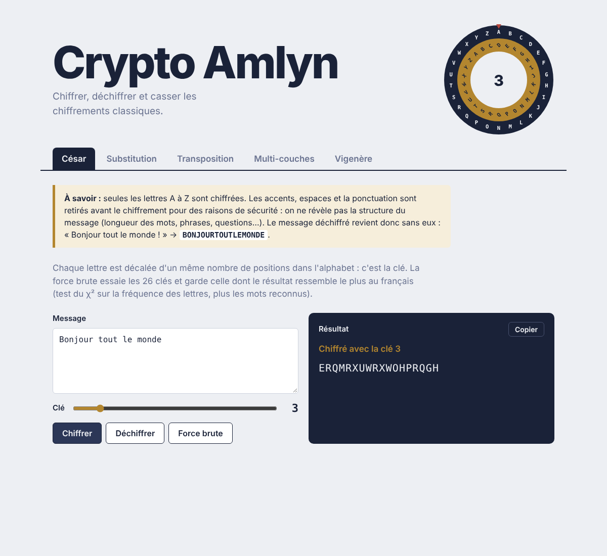
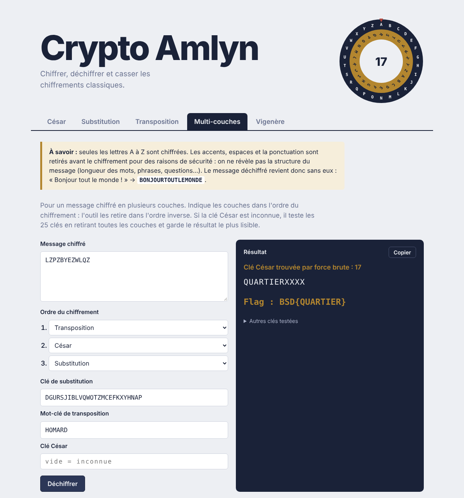
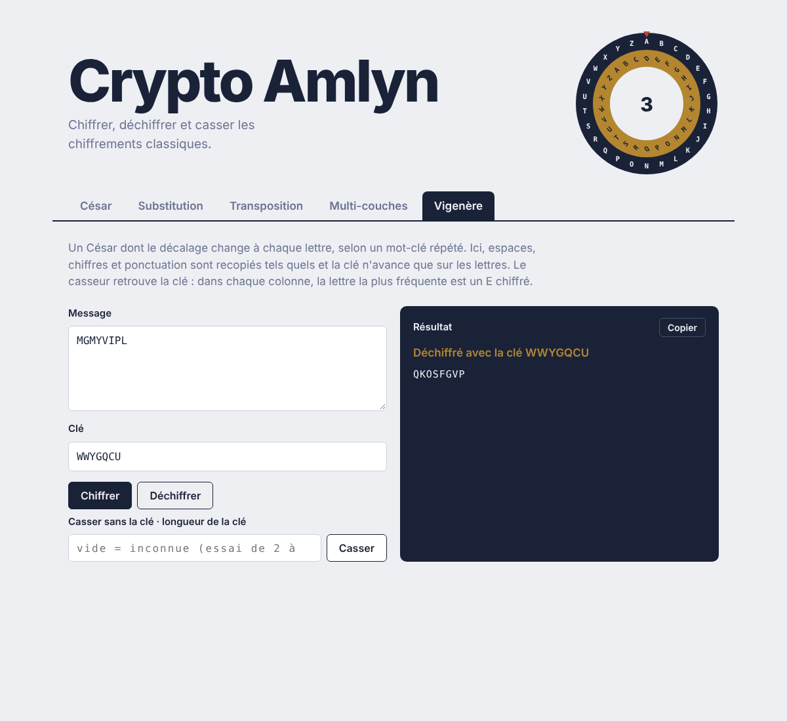
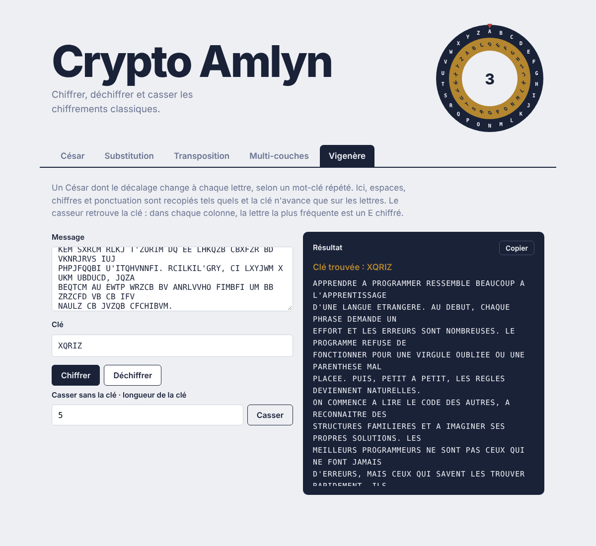
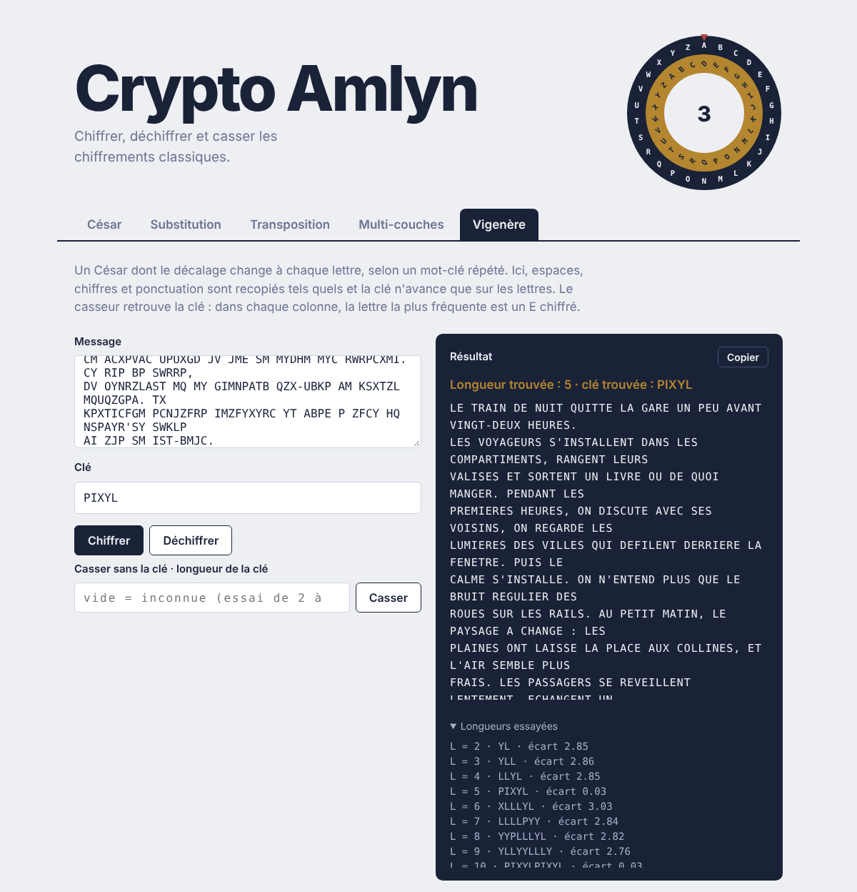

# Crypto Amlyn 🔐

Outil de cryptographie classique (projet CryptoBox), construit brique par brique au fil des séances de TP.
Tous les algorithmes sont codés à la main en JavaScript, sans bibliothèque de cryptographie.

**Version en ligne :** https://am-izer.github.io/crypto-amlyn/

## Lancer l'outil

- **En ligne :** ouvrir le lien ci-dessus.
- **En local :** télécharger le dépôt, puis double-cliquer sur `index.html`. Il s'ouvre dans le navigateur, rien à installer.

## Organisation du code

| Fichier | Rôle |
|---|---|
| `script.js` | Logique de tous les chiffrements (aucun affichage) |
| `interface.js` | Affichage : boutons, onglets, roue de César, grille, résultats |
| `index.html` | Structure de la page (un onglet par technique) |
| `style.css` | Mise en forme |
| `captures/` | Captures d'écran du README |

---

## Brique 1 · César, substitution, transposition

Convention : lettres majuscules A à Z uniquement. La fonction `nettoyer()` retire accents, espaces,
ponctuation et chiffres avant le chiffrement.

### César
- **Principe :** chaque lettre est décalée de k positions : `C = (M + k) mod 26`.
- **Code :** `cesar(texte, k)` parcourt les lettres, prend leur rang dans l'alphabet et ajoute k modulo 26.
  Déchiffrer revient à décaler de −k.
- **Force brute** (`forceBrute`) : on teste les 25 clés et on garde le texte qui ressemble le plus au
  français. La note combine le **test du χ²** sur la fréquence des lettres et un bonus pour les mots
  français reconnus (`score`).

### Substitution
- **Principe :** la clé est un alphabet de 26 lettres. A est remplacé par la 1re lettre de la clé, B par la 2e…
- **Code :** `substitution(texte, cle, chiffrer)` cherche la position de la lettre dans l'alphabet et prend
  la lettre de même position dans la clé (l'inverse pour déchiffrer). `genererCle()` mélange l'alphabet
  (algorithme de Fisher-Yates). La clé est vérifiée : 26 lettres, chacune une seule fois.

### Transposition par colonnes
- **Principe :** on écrit le message en lignes sous le mot-clé (dernière ligne complétée par des X),
  puis on lit les colonnes dans l'ordre alphabétique des lettres du mot-clé.
- **Code :** `ordreColonnes(motCle)` trie les indices des colonnes selon leurs lettres.
  `transpositionChiffrer` lit chaque colonne de haut en bas dans cet ordre. `transpositionDechiffrer`
  fait l'inverse : il remplit les colonnes dans l'ordre de lecture, puis relit ligne par ligne.

### Multi-couches (challenge du TP 1)
- `dechiffrerCouches` retire les couches dans l'ordre inverse du chiffrement.
- `forceBruteCouches` : si la clé César est inconnue, pour chaque k de 1 à 25, on retire **toutes** les
  couches puis on note le résultat. On garde le plus lisible.

### Tests (exemples du sujet)
| Technique | Clé | Entrée | Sortie |
|---|---|---|---|
| César | 3 | BONJOUR | ERQMRXU |
| Substitution | QWERTYUIOPASDFGHJKLZXCVBNM | ATTAQUE | QZZQJXT |
| Transposition | PORTE | RENDEZVOUSAMIDI | ESIEVMRZANOIDUD |

---

## Brique 2 · Vigenère et casseur

### Vigenère (partie A)
- **Principe :** un César dont le décalage change à chaque lettre. La clé est répétée sous le message,
  et chaque lettre est décalée du rang de la lettre de clé correspondante (A = 0, B = 1…).
- **Conventions du TP 2 :** tout en majuscules, accents retirés (`sansAccents`), espaces, chiffres et
  ponctuation recopiés tels quels. **La clé n'avance que sur les lettres.**
- **Code :** `vigenere(texte, cle, sens)` garde un compteur `j` qui n'augmente que lorsqu'une lettre est
  chiffrée. Lettre chiffrée = `(lettre + sens × cle[j mod longueur]) mod 26`, avec `sens = +1` pour
  chiffrer et `−1` pour déchiffrer.

| Clé | Entrée | Sortie |
|---|---|---|
| CLE | ATTAQUE A L'AUBE | CEXCBYG L P'CFFG |
| TP | LA CLE, 14H | EP VAX, 14W |

### Casseur, longueur connue (partie B)
`casserVigenere(texte, L)` :
1. garde seulement les lettres du texte chiffré ;
2. découpe en L colonnes (lettres 1, 1+L, 1+2L… dans la colonne 1, etc.) : chaque colonne est un simple
   César ;
3. compte les lettres de chaque colonne : la plus fréquente est un **E** chiffré (E est la lettre la plus
   fréquente en français) ;
4. lettre de clé = `(lettre la plus fréquente − E) mod 26` ;
5. assemble les L lettres pour obtenir la clé. On vérifie en déchiffrant avec la partie A.

### Casseur, longueur inconnue (bonus)
`casserVigenereSansLongueur(texte)` essaie L = 2 à 10. Pour chaque L, il casse la clé, déchiffre, et
mesure l'écart avec le français (χ² divisé par le nombre de lettres). Un texte lisible a un écart très
faible. Les multiples de la vraie longueur donnent aussi un texte lisible : on garde donc **la plus
petite** longueur dont l'écart est proche du meilleur.

---

## Limites
- Les casseurs (César, Vigenère) sont réglés pour le **français** : ils comparent le texte aux fréquences
  des lettres en français.
- Le casseur de Vigenère a besoin d'un texte assez long : sur quelques mots, la lettre la plus fréquente
  d'une colonne n'est pas forcément un E.
